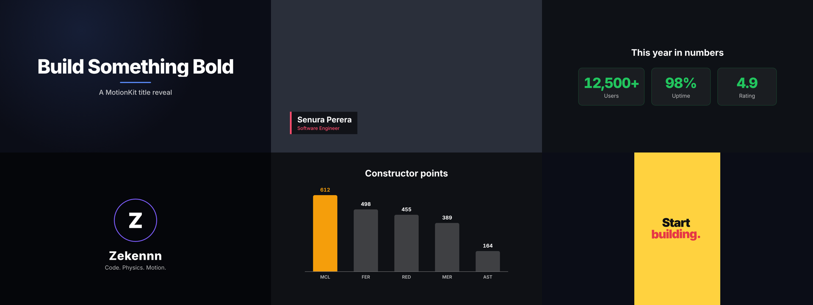

# Tween

**Motion graphics for Claude Code, powered by [Remotion](https://www.remotion.dev).**

Describe a video in plain words. Claude plans the timeline, writes frame-accurate React,
and renders it to MP4. Titles, lower thirds, animated stats, kinetic typography, logo
reveals and data charts, in any format.

```
/tween-scene 10 second promo for my gym app, dark theme, 9:16, ends with "Join today"
```



## Install

Inside Claude Code:

```
/plugin marketplace add Zekennn/tween
```
```
/plugin install tween@tween
```

Then restart Claude Code.

**Requirements:** Node.js 18+ (LTS recommended). Remotion downloads its own headless browser
the first time you render.

## Commands

| Command | What it does |
|---|---|
| `/tween-new [name] [brief]` | Create a new Remotion project, ready to preview |
| `/tween-template <type> [details]` | Drop in a ready template: `title`, `lowerthird`, `stats`, `kinetic`, `logo`, `chart`, `apple-headline`, `apple-product`, `apple-bento`, `editorial-title`, `editorial-stats`, `type-stack`, `warm-path`, `warm-tagline`, `captions`, `split-compare` |
| `/tween-scene <brief>` | Design and build a custom scene or full video from a description |
| `/tween-render [id] [mp4\|gif\|still\|transparent\|4k]` | Export the video |

You can also just ask normally, e.g. *"make a lower third for my name"*. The skill loads
automatically whenever you're working on motion graphics or inside a Remotion project.

## What makes it different

- **Render-safe by default.** Claude follows Remotion's hard rules: every animation driven by
  `useCurrentFrame()`, clamped interpolation, deterministic randomness, properly loaded
  fonts and assets. No flicker, no desync.
- **Motion design built in.** Easing, staggering, overlap, readable hold times, safe areas
  and type scale, so results look designed, not generated.
- **Sixteen tested templates** (including Apple keynote, editorial showreel, warm studio and creator caption sets) that scale to 16:9, 9:16 and 1:1 automatically.
- **A reviewer agent** (`tween-reviewer`) that checks scenes for render bugs and weak motion.

## Templates

| Template | Use |
|---|---|
| TitleReveal | Masked word-by-word title with accent line |
| LowerThird | Name/role overlay, can render transparent for video editors |
| StatCounter | Animated counting numbers in cards |
| KineticText | Punchy social typography, one line per beat |
| LogoReveal | Particles converge, ring draws, logo springs in |
| BarChart | Bars grow staggered with counting values |

### Apple-style set

Calm, premium keynote look: blur-in entrances on long expo-out easing, slow camera push,
gradient text, no bounce. Just ask for "Apple style" or use the templates directly.

| Template | Use |
|---|---|
| AppleHeadline | Eyebrow plus 1-3 big lines blurring in, one in sweeping gradient |
| AppleProductReveal | Product rises from below with perspective and a light sweep; name and tagline above |
| AppleBento | Rounded "by the numbers" tiles that blur in and count up |

```
/tween-template apple-product "Nova One, Power that fits in your pocket, image phone.png"
```

*Style inspired by product keynotes. Not affiliated with Apple; don't use Apple's logos,
product names or the SF Pro font in your videos.*

### Editorial showreel set

Swiss designer-reel look: heavy capitals snapping out of masks with real motion blur,
slot-machine numbers, hairline rules, mono labels, one hot accent, hard cuts.

| Template | Use |
|---|---|
| EditorialTitle | Capitals rise word by word, accent full stop drops in, mono subtitle types on |
| EditorialStats | Big numbers on hairline rows, digits roll in, labels type on |
| TypeStack | One word repeated in solid/outline rows drifting past, accent band, corner HUD |

### Warm studio set

Sketch-to-motion product film: paper cards in warm dark light, soft pops, glow, italic serif.

| Template | Use |
|---|---|
| WarmPathDemo | A rough sketch draws itself; a glowing orb smooths the same path on a grid panel |
| WarmGlowTagline | Glowing starburst, dashed lines to floating cards, letter-by-letter serif tagline |

### Creator set

Talking-head tutorial look for your own footage.

| Template | Use |
|---|---|
| WordCaptions | One caption word at a time, timed from a transcript (`@remotion/captions` format) |
| SplitCompare | Before/after clips with labels, red title banner, presenter in the other half |

```
/tween-template editorial-title "Studio Nova. Motion design, showreel 2026" vertical
```
```
/tween-template captions "talk.mp4, use my transcript captions.json"
```

## Quick start

```
/tween-new launch-video
/tween-template kinetic "Stop scrolling. Start *building*. Ship it *today*." vertical
/tween-render
```

## Structure

```
tween/
├── .claude-plugin/
│   ├── plugin.json
│   └── marketplace.json
├── skills/tween/
│   ├── SKILL.md              # core rules, workflow, design principles
│   ├── references/           # animation patterns, styles (Apple, editorial, warm, creator), layouts, audio, rendering
│   └── templates/            # 16 ready Remotion components
├── commands/                 # /tween-new, /tween-template, /tween-scene, /tween-render
└── agents/tween-reviewer.md
```

## Notes

- Remotion has its own [license](https://www.remotion.dev/license): free for individuals and
  small companies; larger companies need a company license. This plugin is MIT, but the
  videos you make use Remotion, so check that page if you use it commercially.
- Remotion also publishes official agent skills (`npx skills add remotion-dev/skills`).
  Tween works alongside them and focuses on motion design quality and ready templates.

## License

MIT © Senura Perera
